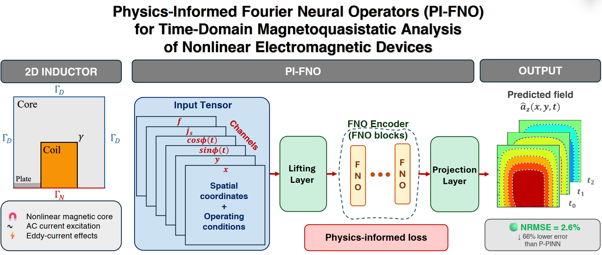
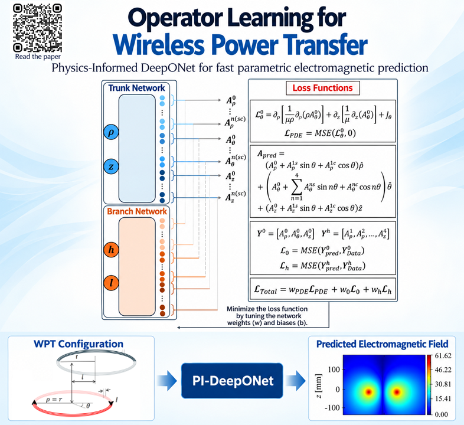
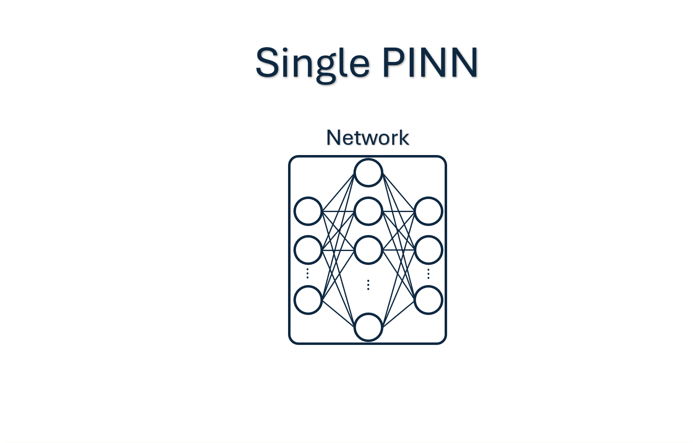
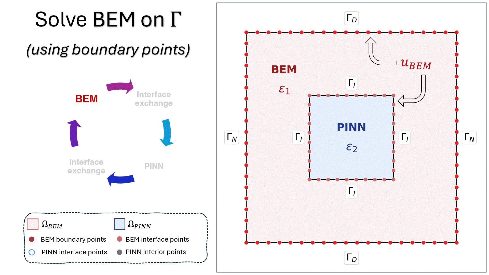
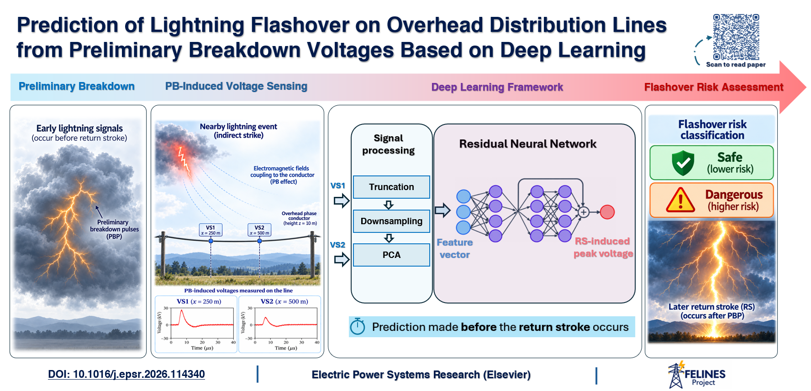

My research lies at the intersection of **scientific machine learning**, **computational electromagnetics**, and **AI for physics**. I develop physics-informed and data-driven numerical approaches for electromagnetic forward and inverse problems, with applications in power systems, biomedical engineering, and geophysical imaging.

<h2>Scientific Machine Learning for PDEs</h2>

I investigate physics-informed neural networks (PINNs), variational and weak-form formulations, and neural operators for solving and accelerating electromagnetic partial differential equations.

**Selected research:**

<h3>Neural Operators for Computational Electromagnetics</h3>

This research line investigates physics-informed neural operators for parametric electromagnetic modeling, surrogate simulation, and efficient prediction of electromagnetic field distributions.

  <h4>1. Physics-Informed Fourier Neural Operators (PI-FNO)</h4>
  
A physics-informed Fourier neural operator framework for time-domain magnetoquasistatic analysis of nonlinear electromagnetic devices. PI-FNO predicts magnetic vector potential distributions across varying excitation currents and frequencies, accounting for nonlinear magnetic materials and eddy currents. Validated on a 2D inductor benchmark, it achieves a time-averaged NRMSE of 2.6% and reduces the average error by more than 66% compared with parametric PINNs on the magnetoquasistatic benchmark.

  <figure style="--figure-width: 650px;">
    
    <figcaption>PI-FNO framework and numerical results for nonlinear magnetoquasistatic analysis.</figcaption>
  </figure>
  
<a href="https://ieeexplore.ieee.org/document/11774833">Paper</a>

  <h4>2. PI-DeepONet for Wireless Power Transfer Coil Coupling</h4>
  
A hybrid physics-informed and data-driven neural operator framework for fast parametric modeling of wireless power transfer systems. Combining Maxwell's equations, FEM-generated data, and Fourier-based field decomposition, PI-DeepONet predicts magnetic field distributions under varying coil misalignments and air-gap conditions, achieving a relative L2 error below 2.6% in magnetic vector potential prediction.

  <figure style="--figure-width: 520px;">
    
    <figcaption>Parametric electromagnetic field prediction for wireless power transfer systems.</figcaption>
  </figure>
  
<a href="https://ieeexplore.ieee.org/document/11717591">Paper</a>

  <h4>3. PI-DeepONet for Parametric Electromagnetic Modeling</h4>
  
A physics-informed neural operator framework for efficient parametric modeling of electromagnetic devices, spanning linear and nonlinear magnetostatics to frequency- and time-domain magnetoquasistatics. By incorporating Maxwell's equations, boundary conditions, and material interface constraints into the learning process, PI-DeepONet enables physically consistent, data-efficient prediction of electromagnetic fields.

  <!-- Optional image: upload /images/PIDeepONet.png, then remove these comment markers.
  <figure style="--figure-width: 650px;">
    
    <figcaption>PI-DeepONet predictions for parametric electromagnetic modeling.</figcaption>
  </figure>
  -->
  
<a href="https://ieeexplore.ieee.org/document/11653419">Paper</a>

<h3>INI-VPINN: Variational Physics-Informed Learning</h3>

This research line investigates variational physics-informed neural networks for solving partial differential equations in complex geometries and multi-material domains.

  <h4>1. INI-VPINN — Original Framework</h4>
  
The INI-VPINN framework uses a variational physics-informed formulation to implicitly enforce Neumann boundary and material interface conditions. It avoids additional penalty terms or separate subdomain networks, providing a unified approach to solving PDEs in heterogeneous domains.

  <figure style="--figure-width: 600px;">
    
    <figcaption>Original INI-VPINN framework and numerical results.</figcaption>
  </figure>
  
<a href="https://arxiv.org/abs/2606.18032">Paper</a> &nbsp;·&nbsp; <a href="https://github.com/ShayanDodge/INI-VPINN">GitHub</a>

  <h4>2. INI-VPINN — Follow-up Research</h4>
  
A related publication in this research line. The exact methodological contributions and numerical validation results will be added once the publication details are confirmed.

  <!-- Optional image: upload /images/ini-vpinn-child.png, then remove these comment markers.
  <figure style="--figure-width: 650px;">
    
    <figcaption>Follow-up method and numerical results.</figcaption>
  </figure>
  -->
  
<a href="https://scholar.google.com/citations?view_op=view_citation&amp;hl=en&amp;user=1usufq0AAAAJ&amp;citation_for_view=1usufq0AAAAJ:MXK_kJrjxJIC">Paper</a>

<h3>Additional Physics-Informed Methods</h3>

  <h4>STAR-PINN — Stacked Adaptive Residual Networks</h4>
  
STAR-PINN uses stacked adaptive residual physics-informed neural networks to model nonlinear magnetic diffusion, supporting accurate solution of electromagnetic partial differential equations.

  <figure style="--figure-width: 650px;">
    
    <figcaption>STAR-PINN architecture and representative magnetic diffusion results.</figcaption>
  </figure>
  
<a href="https://doi.org/10.1109/ACCESS.2025.3597869">Paper</a> &nbsp;·&nbsp; <a href="https://github.com/ShayanDodge/star-pinn-magnetic-diffusion">Code</a>

  <h4>Hybrid BEM–PINN for Computational Electromagnetics</h4>
  
A hybrid computational framework combining boundary element methods (BEM) with physics-informed neural networks to solve electromagnetic boundary-value problems, leveraging boundary formulations alongside physics-informed learning.

  <figure style="--figure-width: 650px;">
    
    <figcaption>Hybrid BEM–PINN approach and representative numerical results.</figcaption>
  </figure>
  
<a href="https://doi.org/10.1109/ACCESS.2024.3500039">Paper</a> &nbsp;·&nbsp; <a href="https://github.com/ShayanDodge/Hybrid-BEM-PINN-Electromagnetics">Code</a>

<h2>AI for Power and Energy Systems</h2>

My research applies machine learning to lightning characterization and power-system protection, particularly through the FELINES research project.

**Selected research:**

  <h4>FELINES — AI for Lightning and Power Systems</h4>
  
Within FELINES, I developed machine-learning approaches for lightning localization, peak-current estimation, and lightning-induced overvoltage prediction. These tools support the analysis of lightning phenomena and power-system protection.

  <!-- Optional figure: upload /images/FELINES.png and remove these comment markers.
  <figure style="--figure-width: 650px;">
    
    <figcaption>Lightning geolocation, current estimation, or overvoltage prediction results.</figcaption>
  </figure>
  -->
  
<a href="https://doi.org/10.1016/j.epsr.2025.111437">Paper</a> &nbsp;·&nbsp; <a href="https://github.com/ShayanDodge/FELINES-Lightning-Forecast">Code</a> &nbsp;·&nbsp; <a href="https://felines.prin.unige.it/">Project</a>

<h2>AI for Biomedical Electromagnetics</h2>

My research includes generative learning and inverse modeling for patient-specific transcranial magnetic stimulation (TMS), alongside deep-learning surrogate models for rapid assessment of specific absorption rate (SAR) in electromagnetic devices.

**Selected research:**

  <h4>STEM-DEEP — AI for Transcranial Magnetic Stimulation</h4>
  
Generative electric-field modeling and inverse coil-placement optimization for TMS, with the goal of supporting patient-specific stimulation planning and efficient electromagnetic analysis.

  <!-- Optional figure: upload /images/STEMDEEP.png and remove these comment markers.
  <figure style="--figure-width: 650px;">
    
    <figcaption>Patient-specific TMS electric-field prediction or coil-placement optimization.</figcaption>
  </figure>
  -->
  
<a href="https://cad.unipv.it/PRIN/prin.html">Research Program</a>

  <h4>Deep-Learning Surrogates for SAR Prediction</h4>
  
Data-driven surrogate modeling for rapid prediction of specific absorption rate (SAR) hotspots in electromagnetic devices, supporting efficient exposure and safety assessment.

  <!-- Optional figure: upload /images/SAR.png and remove these comment markers.
  <figure style="--figure-width: 650px;">
    
    <figcaption>Reference and surrogate-predicted SAR distributions.</figcaption>
  </figure>
  -->
  
<a href="https://doi.org/10.1049/smt2.70009">Paper</a>

<h2>Geophysical Inversion and Scientific Computing</h2>

My research covers physics-informed and data-driven approaches to geophysical electromagnetic inverse problems, together with high-performance computational electromagnetics.

**Selected research:**

  <h4>AIGEO — AI for Geophysical Electromagnetic Inversion</h4>
  
Ongoing research on physics-informed and data-driven inverse modeling for geophysical applications, including electrical resistivity tomography (ERT), to support subsurface characterization.

  <!-- Optional figure: upload /images/AIGEO.png and remove these comment markers.
  <figure style="--figure-width: 650px;">
    
    <figcaption>Geophysical inversion workflow or reconstructed resistivity distribution.</figcaption>
  </figure>
  -->
  
<em>Ongoing research</em>

  <h4>GPU-Accelerated FDTD for Electromagnetic Wave Propagation</h4>
  
High-performance finite-difference time-domain (FDTD) modeling of electromagnetic wave propagation in plasma using GPU acceleration.

  <!-- Optional figure: upload /images/FDTD.png and remove these comment markers.
  <figure style="--figure-width: 650px;">
    
    <figcaption>Simulated electromagnetic wave propagation in plasma.</figcaption>
  </figure>
  -->
  
<a href="https://arxiv.org/abs/2211.05647">Preprint</a>

---

For research announcements, visit my [blog](/year-archive/). For my full academic record, see the [CV](/files/Shayan_Dodge_CV.pdf).
